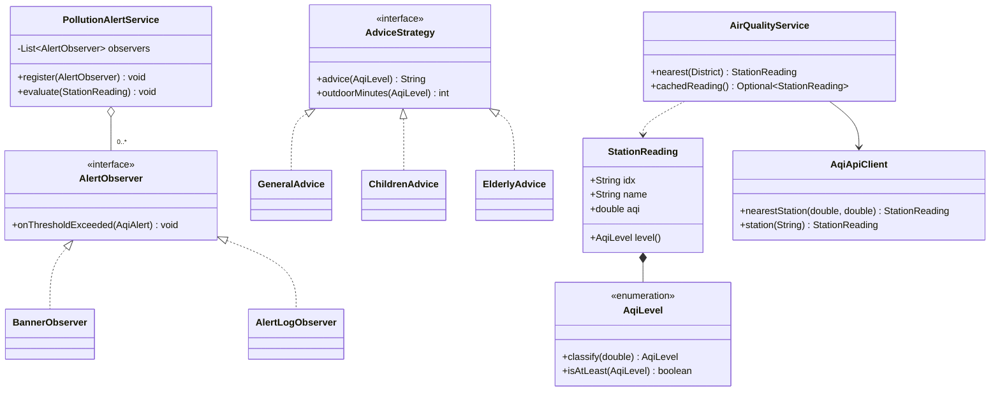

# Air & Green 报告素材（简体中文草稿）

> 用途：这是 `docs/report.typ` 各章节的简体中文内容草稿，供你翻译并写入正式报告。
> 正文（第 1–6 节）约 5,000 个汉字，译成英文约 2,900–3,100 词，落在 2,500–3,200 词的要求内。
> 表格、代码块、图注不计入字数。参考文献保留英文 APA 7 格式，不要翻译。
> 引用标记 `[1]` 对应第 7 节编号；正式报告中请改为 APA 作者—年份格式（如 Gamma et al., 1994）。

---

## 1. 引言与 SDG 11 背景

### 1.1 城市问题与运营机构

空气污染是当代城市最普遍、也最容易被低估的公共健康问题之一。世界卫生组织指出，全球约 99% 的人口呼吸着超过其空气质量指导值的空气，室外空气污染每年造成约 420 万例过早死亡[6]。在马来西亚巴生谷，机动车尾气、建筑扬尘、露天焚烧和工业排放叠加，加上旱季静稳天气，空气质量经常在数小时内从"良好"恶化到"不健康"。市民面对手机上的一串 AQI 数字，通常无法回答三个更实际的问题：我现在应不应该带孩子去公园？附近的绿地哪一处空气相对更好？我发现一处露天焚烧，应该向谁报告？

本项目开发的 **Air & Green** 是一个面向城市社区的桌面监测系统，把"读数—建议—绿地—举报—预警"串成一条完整的行动链。系统的运营机构设定为**吉隆坡市政局（DBKL）环境健康与城市清洁部门**：该部门负责空气质量管理、公共绿地维护和市民投诉受理，具备运营本系统的职责与数据权限。系统既可以安装在社区服务中心的公共查询终端，也可以作为环境官员的工作站工具。

### 1.2 SDG 11 目标对应

系统直接服务于 SDG 11 的两项具体目标：

- **目标 11.6**：到 2030 年，减少城市人均环境负面影响，**特别关注空气质量**和市政及其他废物管理。Air & Green 的实时读数、分区查询和阈值预警正是针对空气质量的直接干预。
- **目标 11.7**：到 2030 年，**普遍提供安全、包容、无障碍的绿色公共空间**。系统按距离排序推荐附近公园，帮助居民把"绿地可达性"转化为具体出行决策。

两项功能不是彼此独立的：系统先判断空气是否适合户外活动，再推荐绿地，避免"空气很差却建议去公园"的自相矛盾。

### 1.3 利益相关者与需求

| 利益相关者 | 角色 | 核心需求 |
|---|---|---|
| 普通居民 | 系统主要使用者 | 快速看懂当前空气质量，知道能否外出运动 |
| 儿童家长 | 高频使用者 | 儿童户外活动时长建议，学校活动决策依据 |
| 老年人及其照护者 | 高敏感人群 | 更保守的出行建议，雾霾时明确的室内提示 |
| DBKL 环境官员 | 系统运营者 | 分区空气状况概览、市民举报汇总、对外发布依据 |
| 社区健康 NGO | 次要使用者 | 制作宣传材料时可引用的分区数据与建议 |
| 系统维护人员 | 技术角色 | API 可用性检查、离线缓存、可追溯的错误信息 |

### 1.4 范围与预计用户

首期部署覆盖巴生谷六个区：吉隆坡市中心、八打灵再也、莎阿南、巴生、布城和赛城。按每个区约 800–1,000 名活跃居民估算，试点规模约 **5,000 名注册居民**，日均查询 1,000–1,500 次；另有约 30 名环境官员使用工作站版本。系统按单城市、单实例设计，不包含多租户、账号体系和跨城市部署；这些属于第 6 节讨论的扩展方向。

---

## 2. 文献综述

### 2.1 现有智慧城市方案与差距

现有空气质量服务大致分为三类。第一类是**全球索引平台**，如 World Air Quality Index（WAQI/aqicn.org）[13]，聚合各国监测站并提供地图与历史曲线；第二类是**商业消费级应用**，如 IQAir AirVisual，强调预报、室内净化器联动和付费订阅；第三类是**开放数据平台**，如 OpenAQ[12]，向开发者提供标准化 API，但本身不面向普通市民。马来西亚环境局也通过 APIMS 发布官方空气污染指数[14]。

这些方案解决了"数据从哪里来"，却没有解决"数据如何变成行动"。具体差距有三点：

1. **建议与人群脱节**：多数应用只给出统一的健康提示，没有区分儿童、老年人和普通成人各自的暴露阈值。
2. **空气与绿地割裂**：空气质量应用不推荐公园，公园导览应用不显示空气状况，居民需要自己在两个应用之间做判断。
3. **缺少本地反馈闭环**：居民看到露天焚烧或工地扬尘，只能拨打热线，问题无法与分区空气数据关联，运营方也难以形成记录。

Air & Green 的定位不是另一个全球地图，而是**社区尺度的行动辅助工具**：用同一份读数驱动分区建议、绿地推荐、举报记录和阈值预警，填补上述三个缺口。

### 2.2 设计模式及其近期应用

本系统采用《设计模式》[1] 中的两种模式：

- **策略模式（Strategy）**：把"不同人群的户外建议"封装为可互换的算法族。`AdviceStrategy` 是抽象策略，`GeneralAdvice`、`ChildrenAdvice`、`ElderlyAdvice` 是具体策略，仪表盘只依赖接口。新增"孕妇"或"呼吸系统疾病患者"分组时，只需新增一个类，不需要修改界面或控制器。
- **观察者模式（Observer）**：`PollutionAlertService` 是被观察主题，`AlertObserver` 是观察者接口，`BannerObserver` 与 `AlertLogObserver` 是两个具体观察者。读数越过阈值时，主题一次性通知所有订阅者；界面横幅与历史列表互不知情。

观察者模式在智慧城市与物联网领域有广泛的近期应用。Razzaque 等人在物联网中间件综述中指出，发布—订阅（publish–subscribe）是传感器事件分发的主流集成风格，其本质就是观察者模式的分布式变体[4]；Zanella 等人关于智慧城市物联网的架构研究同样把事件驱动的数据分发作为城市服务的基础设施[5]。这说明本系统选择观察者而非轮询，与行业实践一致。

### 2.3 使用的 Java 技术

实现采用 Java 17 与 Maven：

- **Swing** 构建桌面 GUI。选择 Swing 而非 JavaFX，是因为 JDK 自带、无需额外运行时，且作业要求明确提到 Swing；界面外观通过 FlatLaf 增强可读性。
- **`java.net.http.HttpClient`**[9] 负责 HTTP 调用。JDK 内置客户端支持超时、连接复用和可中断请求，避免引入额外框架。
- **Gson**[10] 负责 JSON 解析。解析逻辑集中在 `AqiJsonParser`，与网络传输分离，便于用固定 JSON 样本做单元测试。
- **JUnit 5**[11] 提供参数化测试、异常断言和分组标签；**JaCoCo** 生成行覆盖率报告；**Maven** 统一构建、测试、打包，产出可直接运行的 fat jar。

### 2.4 城市问题的量化证据

除 WHO 的全球数据外，联合国人居署《World Cities Report 2022》指出，城市容纳了全球约 56% 的人口，并贡献了绝大部分能源消耗与温室气体排放，城市因此既是污染源，也是治理的关键尺度[8]。这为"以分区为单位"设计监测与建议提供了依据：同一座城市内不同分区的污染水平与绿地可达性差异显著，统一的城市级提示不足以支撑个人决策。

---

## 3. 系统设计与建模

### 3.1 架构

系统采用四层结构，依赖方向自上而下，领域模型不依赖任何框架：

| 层 | 关键类 | 职责 |
|---|---|---|
| 表示层（View） | `MainFrame`、`DashboardPanel`、`StationsPanel`、`ReportsPanel`、`AlertsPanel` | 只负责渲染与收集输入 |
| 控制层（Controller） | `DashboardController`、`StationsController`、`ReportsController`、`AlertsController`、`Async` | 处理事件、调度后台任务、更新视图 |
| 服务层（Service） | `AirQualityService`、`ParksService`、`ReportService`、`LocalStore`、`SettingsStore`、`PollutionAlertService` | 业务规则、缓存、持久化、预警 |
| 接口层（API） | `AqiApiClient`、`JdkHttpTransport`、`AqiJsonParser`、`ApiException` | HTTP、JSON、错误归一化 |
| 领域模型（Model） | `StationReading`、`AqiLevel`、`District`、`Park`、`CitizenReport` | 不可变数据与分类规则 |

一次刷新的数据流：用户点击 Refresh → `DashboardController` 读取所选分区 → `Async` 在后台线程调用 `AirQualityService.nearest` → `AqiApiClient` 拼装 URL → `JdkHttpTransport` 发起 GET → `AqiJsonParser` 把 JSON 转为 `StationReading` → `LocalStore` 写入缓存 → 控制器回到事件分发线程调用 `DashboardPanel.showReading`，并把读数交给 `PollutionAlertService.evaluate` → 主题通知两个观察者。

### 3.2 UML 类图

正式报告需要一张至少包含六个类的类图（IS-A/HAS-A、字段类型、方法签名、可见性、多重性）。建议用下面的 Mermaid 片段生成底图，再按作业要求补全：



关键关系说明：三个建议类实现 `AdviceStrategy`（IS-A）；`PollutionAlertService` 持有零到多个 `AlertObserver`（HAS-A，0..*，组合）；`StationReading` 由 `AqiLevel` 分类（依赖）；`AirQualityService` 组合 `AqiApiClient` 并产出 `StationReading`；`DashboardController` 依赖 `AirQualityService`、`ParksService` 与 `PollutionAlertService`。

### 3.3 设计模式论证

#### 3.3.1 策略模式：按人群切换建议

**修改前**（if-else 链，新增人群必须修改方法）：

```java
public String advice(String audience, double aqi) {
    if (audience.equals("general")) {
        if (aqi <= 50) return "Outdoor activity is safe.";
        if (aqi <= 100) return "Reduce long outdoor exertion.";
        return "Avoid outdoor exertion.";
    } else if (audience.equals("children")) {
        // 另一整套阈值与措辞
    }
    // 每增加一个群体，这个方法继续变长
}
```

**修改后**（策略族，调用方只依赖接口）：

```java
public interface AdviceStrategy {
    String advice(AqiLevel level);
    int outdoorMinutes(AqiLevel level);
}

public final class ChildrenAdvice implements AdviceStrategy {
    @Override
    public String advice(AqiLevel level) {
        return switch (level) {
            case GOOD -> "Good air for play.";
            case MODERATE -> "Outdoor play is fine; watch asthma.";
            case SENSITIVE -> "Move vigorous play indoors.";
            default -> "Keep children indoors.";
        };
    }
}
```

**体现的 SOLID 原则**：开闭原则（OCP）。新增人群通过新增类完成，`DashboardPanel` 与 `DashboardController` 无需修改；同时也满足单一职责（SRP），每个类只描述一个人群的建议。相比 if-else，策略把"变化点"隔离到类边界，单元测试可以逐一验证每个人群，而不必构造巨大的条件组合。

#### 3.3.2 观察者模式：阈值预警

**修改前**（主题直接调用界面组件）：

```java
public void evaluate(StationReading reading) {
    if (reading.aqi() > threshold) {
        statusBar.setText("Alert: " + reading.aqi()); // 主题依赖 GUI
        notificationHistory.add(reading);             // 主题依赖历史记录
    }
}
```

**修改后**（主题只认识观察者接口）：

```java
public void evaluate(StationReading reading) {
    AqiLevel level = reading.level();
    if (!level.isAtLeast(required)) { lastAnnounced = null; return; }
    if (lastAnnounced != null && !level.isWorseThan(lastAnnounced)) return;

    lastAnnounced = level;
    AqiAlert alert = new AqiAlert(level, reading.aqi(),
            reading.name(), System.currentTimeMillis());
    for (AlertObserver observer : observers) {
        observer.onThresholdExceeded(alert);
    }
}
```

**体现的 SOLID 原则**：依赖倒置（DIP）与开闭原则。主题依赖抽象 `AlertObserver`，不依赖 Swing；新增"写入日志文件"或"发送邮件"的观察者时，主题不变。单一职责也得到保持：主题只判断"是否越级"，两个观察者分别负责"显示"和"记录"。

### 3.4 CRC 卡片

| 类名 | 职责 | 协作对象 |
|---|---|---|
| `AqiLevel` | 把数值 AQI 分类为六个等级；提供等级比较 | `StationReading`、`AdviceStrategy`、`PollutionAlertService` |
| `AdviceStrategy`（及三个实现） | 根据等级与人群生成建议和户外时长 | `DashboardController`、`DashboardPanel` |
| `PollutionAlertService` | 判断读数是否越过阈值、是否比上次更严重；通知观察者 | `AlertObserver`、`SettingsStore`、`StationReading` |
| `AirQualityService` | 调用 API 获取读数、写入缓存、读取缓存 | `AqiApiClient`、`LocalStore`、`DashboardController` |
| `AqiApiClient` | 拼装请求、检查状态码、委托解析 | `HttpTransport`、`AqiJsonParser`、`ApiException` |

---

## 4. 实现与单元测试

### 4.1 核心逻辑与整洁代码

**命名与结构**：类名使用领域名词（`StationReading`、`NearbyPark`），方法名使用动词（`nearest`、`evaluate`、`register`），布尔方法以 `is` 开头（`isEnabled`、`isWorseThan`）。公开 API 均有 Javadoc，说明参数、返回值与异常。

**方法长度与复杂度**：服务层与接口层的方法均控制在 20 行以内，判断分支以提前返回展开，避免深层嵌套。例如 `AqiJsonParser.number` 只做"取值、判空、回退"三件事；`PollutionAlertService.evaluate` 先处理禁用与未知读数，再处理去重，最后才广播。

**消除魔法数字**：AQI 分段下限定义在枚举构造参数中（`MODERATE("Moderate", 51)`），地球半径、默认返回数量、最大举报长度、HTTP 超时都声明为具名常量（`EARTH_RADIUS_KM`、`DEFAULT_LIMIT`、`MAX_NOTE_LENGTH`、`REQUEST_TIMEOUT`）。

**单一职责示例**：`AqiLevel` 只负责"数值 → 等级"和等级比较，不负责颜色、不负责文案、不负责网络。颜色在 `ui/AqiColors`，文案在策略类，数据在 `StationReading`。因此 `AqiLevelTest` 可以在毫秒级覆盖全部边界值。

**开闭原则示例**：`AdviceStrategies` 是唯一知道全部策略的地方；`DashboardController` 通过 `AdviceStrategy` 接口调用。新增策略时只改注册表与新增类，控制器和视图零改动。这与 3.3.1 的修改前后对比一致。

**模式实现片段**：观察者的注册与广播位于 `PollutionAlertService`，核心不足 25 行：

```java
public void register(AlertObserver observer) {
    observers.addIfAbsent(observer);
}

public void evaluate(StationReading reading) {
    AlertThreshold current = threshold.get();
    if (!current.isEnabled()) { lastAnnounced = null; return; }

    AqiLevel level = reading.level();
    AqiLevel required = current.level().orElseThrow();
    if (level == AqiLevel.UNKNOWN || !level.isAtLeast(required)) {
        lastAnnounced = null;
        return;
    }
    if (lastAnnounced != null && !level.isWorseThan(lastAnnounced)) {
        return;
    }
    announce(new AqiAlert(level, reading.aqi(), reading.name(),
            System.currentTimeMillis()));
}
```

### 4.2 单元测试

测试套件共有 **63 个测试方法**（不含 3 个联网测试），默认构建执行 **78 次**（参数化测试展开后）。覆盖 model、api、service、advice 与 alerts 五个包：

| 测试类 | 方法数 | 重点 |
|---|---:|---|
| `AqiLevelTest` | 5 | 12 个边界值、非法输入、等级比较 |
| `AdviceStrategiesTest` | 6 | 3 个策略全覆盖、回退、户外时长递减 |
| `AqiJsonParserTest` | 8 | 正常/缺字段/空序列/错误信封 |
| `AqiApiClientTest` | 10 | 2xx、404、500、不可读响应、IO 失败、URL 拼装 |
| `AirQualityServiceTest` | 5 | 成功缓存、失败保留旧缓存、站点目录缓存 |
| `PollutionAlertServiceTest` | 8 | 注册/注销、多观察者、同波段去重、恶化再报、禁用 |
| `ParksServiceTest` | 7 | 距离排序、数量限制、非法参数、数据集完整性 |
| `ReportServiceTest` | 8 | 增删查、空白校验、超长校验、持久化 |
| `LocalStoreTest` | 6 | 读数/举报/站点/设置往返、损坏文件降级 |

作业要求的断言类型均已使用：**3 个 `@ParameterizedTest`**（AQI 边界、策略全覆盖、策略键解析）、**20 处 `assertThrows`**、**35 处 `assertAll`**。测试命名统一为 `methodName_scenario_expectedBehaviour`，例如 `disabledThreshold_neverAlerts`、`unknownStation_reportsNotFound`。

**覆盖率**：`mvn verify` 生成 JaCoCo 报告，行覆盖率为 **80.4%**（指令 85.1%，分支 77.6%）。统计排除 `ui`、`controller` 与 `App`：这些类只做布局和事件转发，由第 5.3 节的系统测试覆盖；业务逻辑层的覆盖率因此更能反映测试质量。

### 4.3 已知限制：一个故意失败的测试

`AqiApiLiveTest.sampleStation_hasAFullSeventyTwoSampleSeries` 断言示例站点返回恰好 72 个序列点，实际会失败。原因是上游 WAQI 会省略站点未上报的时段，接口虽然承诺"72 小时序列"，但返回的点数少于 72，且包含 `null`。应用在解析时跳过 `null`，因此趋势序列长度不固定。

这个失败测试记录了一个真实限制：系统不能假设固定分辨率，也不能用序列长度推断数据完整性。若未来要绘制严格 72 小时的趋势，需要在服务端补齐缺失时段并在界面上标注"估算值"，而不是在客户端假装数据完整。报告附录 A 保留该测试的失败输出与说明。

---

## 5. 集成与应用

### 5.1 GUI 与 MVC

系统明确区分三类角色：

- **Model**：`StationReading`、`AqiLevel`、`District`、`Park`、`CitizenReport`、`AqiAlert`。它们不引用 Swing，也不发起网络请求。
- **View**：`MainFrame`（四个标签页 + 状态栏）、`DashboardPanel`、`StationsPanel`、`ReportsPanel`、`AlertsPanel`。视图只暴露 `showReading`、`showParks`、`showReports` 等方法，不包含业务判断。
- **Controller**：`DashboardController`、`StationsController`、`ReportsController`、`AlertsController`。控制器从视图读取输入，调用服务，再把结果写回视图；耗时操作通过 `Async`（`SwingWorker`）离开事件分发线程。

**输入校验**：`ReportService.add` 是唯一校验入口——分区不能为空、类别不能为空、描述不能为空白、描述不超过 500 字，违规时抛出带用户可读消息的 `IllegalArgumentException`；`ReportsController` 捕获后调用 `view.showMessage`，界面不会出现堆栈信息。`AqiApiClient` 对状态码与 JSON 结构做同样的归一化。

**主用例追踪（从输入到输出）**：用户在"Air quality"页选择 *Petaling Jaya* 并点击 *Refresh* → `DashboardPanel` 触发 `DashboardController.refresh()` → `Async.run` 在后台线程调用 `AirQualityService.nearest(PETALING_JAYA)` → `AqiApiClient.nearestStation(3.1073, 101.6067)` → `JdkHttpTransport` 发出 `GET /nearest-station?lat=3.1073&lon=101.6067` → 返回 200 后 `AqiJsonParser.parseStation` 生成 `StationReading` → `LocalStore.saveReading` 写缓存 → 回到事件分发线程，`DashboardPanel.showReading` 更新 AQI、等级、污染物与更新时间，`showParks` 用 Haversine 距离填充公园列表 → `PollutionAlertService.evaluate` 判断是否越级，若是则 `BannerObserver` 更新状态栏、`AlertLogObserver` 追加历史。

### 5.2 外部 API

| 项目 | 内容 |
|---|---|
| API 名称 | AQI API（WAQI 数据的只读封装） |
| 基址 | `https://aqi-api-melvin.fly.dev` |
| 端点 | `/Index/liveness`、`/nearest-station`、`/stations`、`/station/:idx` |
| 成功响应 | 200 + JSON；liveness 为 204 |
| 错误响应 | `{"error":{"code":"...","message":"..."}}` |

**JSON 解析**：`AqiJsonParser` 用 Gson 的 `JsonObject` 树模型逐字段读取，而不是把整个响应绑定到 DTO。这样做的好处是：缺失字段有明确默认值（名称空串、AQI 为 `NaN`、时间为 0），`null` 序列点被跳过，上游新增字段不会导致解析失败。

**状态码处理**：`AqiApiClient.read` 先判断 `status / 100 != 2`，再解析 JSON；`ApiException.messageFor` 为 404、429、5xx 和网络失败分别提供用户可读消息。若响应体带有 `error.message`，优先使用服务端消息；否则回退到本地文案。界面只显示 `failure.getMessage()`，从不显示异常类名或堆栈。

**优雅降级**：每次成功读取都写入 `~/.airngreen/last-reading.json`。请求失败时，`DashboardController.onFailure` 读取缓存并显示，同时用橙色提示"Offline: showing the last saved reading"，状态栏说明失败原因；若从未成功读取，则只显示错误提示与公园列表。站点目录同样有缓存，离线时仍可浏览。

### 5.3 系统集成测试（Template 1）

| 测试 ID | 输入 / 操作 | 预期输出 | 实际结果 | 类别 | 状态 |
|---|---|---|---|---|---|
| TC-01 | 在 Dashboard 选择 Kuala Lumpur，点击 Refresh | AQI 卡片显示站点名、数值与等级；状态栏显示加载完成 | 与预期一致 | 正常 API 调用 | PASS |
| TC-02 | 打开 Stations 页，加载目录，搜索 "Kapit"，双击该行 | 表格过滤为一条记录；下方详情显示 AQI 25、等级 Good、样本数 | 与预期一致 | GUI 操作 | PASS |
| TC-03 | 以 `-Dairngreen.apiBase=http://127.0.0.1:8080` 启动，桩服务对所有请求返回 500 | 顶部显示"The air-quality service is unavailable. Showing the last saved reading."；若有缓存则继续显示旧读数 | 与预期一致 | 失败 API 响应 | PASS |
| TC-04 | 在 Alerts 页把阈值设为 Moderate or worse，返回 Dashboard 刷新至 AQI > 50 的分区 | 状态栏出现 "ALERT: Moderate (AQI …)"；Alerts 页历史新增一条；同一波段再次刷新不重复 | 与预期一致 | 端到端逻辑 | PASS |
| TC-05 | 在 Reports 页不填描述直接提交；随后填写 501 字描述再次提交 | 第一次提示"Describe what you observed."；第二次提示"Keep the description under 500 characters."；均不写入表格 | 与预期一致 | 边界情况 | PASS |

截图要求：TC-01 的 Dashboard、TC-02 的 Stations、TC-03 的离线提示、TC-04 的告警横幅与历史、TC-05 的校验提示；另需一张 JaCoCo 报告截图与一张 GitHub Actions 绿色运行截图。

---

## 6. 反思与 SDG 11 对齐

**SDG 11 影响**：直接受益群体是**巴生谷有学龄儿童的家庭**。家长每天需要决定孩子能否在户外活动；系统把一句"AQI 108"翻译成"儿童应把剧烈运动移到室内，建议户外时间 15 分钟"，并给出最近公园的距离。可衡量的变化是**决策时间**与**无效出行次数**：试点可通过问卷比较使用前后"查空气—决定是否出门"所需时间，并把"因空气差而取消的户外活动"作为次要指标。WHO 的指导值[6]为"何为不健康"提供了外部依据，使建议不是产品主观设定。

**权衡一：静态公园数据集 vs 实时 OSM 查询**。系统内置 17 个公园的坐标，离线可用、结果确定、可单元测试，代价是覆盖范围有限、无法反映新开放的绿地。若改用 Overpass API，数据更新更及时，但引入第二个外部依赖、速率限制和解析复杂度，且在离线演示时不可用。对试点规模而言，可维护的静态数据比不稳定的实时数据更有价值。

**权衡二：桌面 Swing vs 移动应用**。桌面版本可以直接产出可执行 jar、在实验机房与社区终端运行、无需应用商店审核，演示与评分环境的风险最低；代价是居民无法随时随地使用，触达率低于手机应用。团队先前的 Android 实现已归档在 `android-app` 分支，未来可作为移动端补充，而不是替代桌面工作站。

**权衡三：JSON 文件 vs 数据库**。`LocalStore` 用四个文件保存读数、举报、站点与设置，零配置、易备份、便于人工检查；代价是没有事务与并发控制，多实例部署时会互相覆盖。单机试点可以接受，城市级部署必须替换。

**可扩展性（5,000 名居民同时使用）**：需要两项具体改动。第一，**把上游调用搬到一个带缓存的服务端**：目前每个客户端各自请求 `/nearest-station`，高峰期会放大上游压力；应在 API 层按分区做 5–10 分钟缓存，客户端只读缓存结果，并增加连接池与请求合并。第二，**把本地 JSON 换成支持并发的存储**：举报写入改为 SQLite（WAL 模式）或 PostgreSQL，按 `district + created_at` 建索引，写入走异步队列；同时为 `/stations` 增加分页与 ETag，避免每次加载 1.35 MB 的全量目录。界面层则把同步刷新改为可取消的后台任务，防止重复点击造成请求风暴。

**团队协作**：最大的挑战是中期从 Android 转向桌面实现。原方案有 80 多个类、地图与 17 种语言，团队成员难以在答辩中解释完整数据流。解决方式是：把 Android 版本完整归档到独立分支，保留可回退的演示；在新主干上按"一个屏幕一个负责人"重新划分（Dashboard、Stations、Reports、Alerts），共用第 3 节的类图与接口约定；每次合并前运行 `mvn verify`，以 CI 绿灯作为集成门槛。这样既保留了原工作，又把每个人都变成自己模块的负责人。

---

## 7. 参考文献（APA 7，保留英文）

1. Gamma, E., Helm, R., Johnson, R., & Vlissides, J. (1994). *Design patterns: Elements of reusable object-oriented software*. Addison-Wesley.
2. Martin, R. C. (2008). *Clean code: A handbook of agile software craftsmanship*. Prentice Hall.
3. Krasner, G. E., & Pope, S. T. (1988). A cookbook for using the model-view-controller user interface paradigm in Smalltalk-80. *Journal of Object-Oriented Programming, 1*(3), 26–49.
4. Razzaque, M. A., Milojevic-Jevric, M., Palade, A., & Clarke, S. (2016). Middleware for Internet of Things: A survey. *IEEE Internet of Things Journal, 3*(1), 70–95. https://doi.org/10.1109/JIOT.2015.2498900
5. Zanella, A., Bui, N., Castellani, A., Vangelista, L., & Zorzi, M. (2014). Internet of Things for smart cities. *IEEE Internet of Things Journal, 1*(1), 22–32. https://doi.org/10.1109/JIOT.2014.2306328
6. World Health Organization. (2021). *WHO global air quality guidelines: Particulate matter (PM2.5 and PM10), ozone, nitrogen dioxide, sulfur dioxide and carbon monoxide*. https://www.who.int/publications/i/item/9789240034228
7. United Nations. (2015). *Transforming our world: The 2030 Agenda for Sustainable Development* (A/RES/70/1). https://sdgs.un.org/2030agenda
8. UN-Habitat. (2022). *World Cities Report 2022: Envisaging the future of cities*. https://unhabitat.org/wcr/
9. Oracle. (2024). *Java SE 17 API specification: java.net.http.HttpClient*. https://docs.oracle.com/en/java/javase/17/docs/api/java.net.http/java/net/http/HttpClient.html
10. Google. (2024). *Gson user guide*. https://github.com/google/gson/blob/main/UserGuide.md
11. JUnit Team. (2024). *JUnit 5 user guide*. https://junit.org/junit5/docs/current/user-guide/
12. OpenAQ. (2024). *OpenAQ API documentation*. https://docs.openaq.org
13. World Air Quality Index Project. (2024). *About the World Air Quality Index project*. https://aqicn.org
14. Department of Environment Malaysia. (2024). *Air Pollutant Index of Malaysia (APIMS)*. https://apims.doe.gov.my

---

## 附录 A：单元测试报告（生成方式）

`mvn test` 会在 `target/surefire-reports/` 生成每个测试类的 XML 与 TXT。正式附录需要"一行一个测试"的表格，建议用以下字段直接从 XML 誊写：

| ID | Class | Method | Input / Scenario | Expected | Actual | Status |
|---|---|---|---|---|---|---|
| UT-01 | AqiLevel | classify_mapsBandBoundaries | AQI = 51 | MODERATE | MODERATE | PASS |
| UT-02 | PollutionAlertService | sameBand_isAnnouncedOnce | 70 后 90，阈值 Moderate | 仅 1 次告警 | 1 次 | PASS |
| UT-03 | ReportService | add_rejectsOverlongNote | 501 字描述 | IllegalArgumentException | 抛出 | PASS |
| UT-… | … | … | … | … | … | … |
| UT-LIVE | AqiApiLiveTest | sampleStation_hasAFullSeventyTwoSampleSeries | 拉取 2609 的 72 小时序列 | 72 个样本 | 少于 72 | **FAIL（已解释）** |

共 63 行（联网测试单列）。覆盖率截图取自 `target/site/jacoco/index.html`。

## 附录 B：AI 使用声明模板

> 本组使用 AI 编程助手辅助生成部分代码、单元测试与文档草稿，使用范围包括：项目脚手架、领域模型与 Swing 视图初稿、JUnit 测试样板、本报告的英文润色。所有 AI 生成的代码均由成员逐行阅读、修改并在答辩中解释；报告中的设计决策、测试结果与反思由成员独立完成并验证。AI 工具名称与版本：__________。使用日期：__________。

---

## 附：写作与提交检查（给自己看，不进报告）

- 正文词数：把第 1–6 节译完后用 Word 统计，控制在 2,500–3,200；表格与代码不计。
- 图表：架构图（4 层 + 箭头）、UML 类图（用 3.2 的 Mermaid 起稿）、4 张 CRC 已在上文。
- 截图：Dashboard、Stations、Alerts（含告警历史）、Reports 校验、离线提示、JaCoCo、GitHub Actions。
- 两个 PR 已合并（#1 可配置 API 基址；#2 本文档），main 上的 CI 为绿色。
- 参考文献 14 条，满足 ≥8；正文引用需与编号一一对应。
- AI 检测与 Turnitin 均需 <20%；翻译时请改写句式，不要逐字机翻。
